&nbsp;
&nbsp;
&nbsp;

# 👋 &nbsp;Hi there

I'm a Computer Science student at Mackenzie (São Paulo). Since the dawn of the AI era, I have had the hunger to learn as much as possible through it. Technology has always been around us: since the invention of the first tool, it changed the way we view the world and solve day-to-day problems. That's how I knew my calling, to solve, to innovate and apply my view to the rest of the universe that surrounds me through technology.

I dawdle in projects where I can see the problem up close. The repositories below are small, tested and honest about their limits: each one has a test suite, CI and a "Limitations" section.

&nbsp;

## 🚀 &nbsp;What I'm building

| Project | What it does | Stack |
|---|---|---|
| 🎧 **[ResolveAI](https://github.com/abiliocoe-source/resolveai)** [live demo](https://resolveaii.streamlit.app/) | Support assistant that only answers from cited policy text and hands risky cases to a person. Evaluated on 36 cases. | Python, scikit-learn, Streamlit |
| 🛵 **[DeliveryOps AI](https://github.com/abiliocoe-source/deliveryops-ai)** [live demo](https://deliveryops-ai.streamlit.app/) | Dashboard for delivery kitchens: late and cancel rates by category, with recommendations backed by the numbers. | Python, pandas, Plotly, Streamlit |
| 🚲 **[DemandLab](https://github.com/abiliocoe-source/demandlab)** [live demo](https://demandlab.streamlit.app/) | Daily demand forecasting on real bike-sharing data, measured against a simple baseline. | Python, scikit-learn, Streamlit |
| 🛡️ **[PR Risk Radar](https://github.com/abiliocoe-source/pr-risk-radar)** [live demo](https://pr-risk-radar.streamlit.app/) | Explainable risk score for Git diffs, with suggested tests. | Python, Streamlit |

&nbsp;

## 🧰 &nbsp;Toolbox

&nbsp;

## 📈 &nbsp;Activity

&nbsp;

[LinkedIn](https://www.linkedin.com/in/abiliocoe) · abiliocoe@gmail.com

🇧🇷 Estudante de Ciência da Computação no Mackenzie, desenvolvendo aplicações com IA e LLMs.
